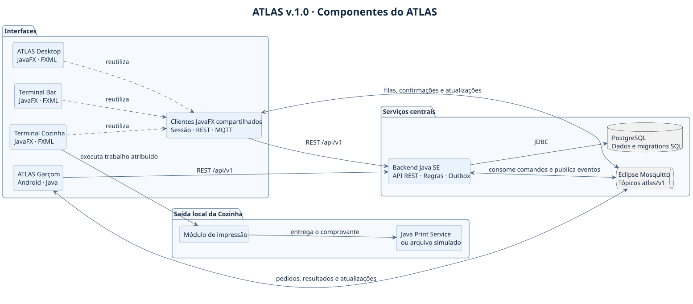

# UML do ATLAS v.1.0

Este conjunto documenta a implementação do ATLAS desde o pedido no Android até a produção, a impressão e o pagamento. Cada vista tem uma imagem vetorial em `svg/` e uma fonte PlantUML editável em `fontes/`.

## Visão geral



## Catálogo de diagramas

| Diagrama | Conteúdo | Fonte |
| --- | --- | --- |
| [Componentes](svg/01-componentes.svg) | Interfaces, componentes compartilhados, API, broker, banco e saída de impressão. | [PlantUML](fontes/01-componentes.puml) |
| [Casos de uso](svg/02-casos-de-uso.svg) | Atores e operações de garçom, gerência, caixa, bar e cozinha. | [PlantUML](fontes/02-casos-de-uso.puml) |
| [Classes do Backend](svg/03-classes-backend.svg) | Entrada, API, MQTT, autorização, pedidos, comandas, catálogo, relatórios, impressão e acesso ao banco. | [PlantUML](fontes/03-classes-backend.puml) |
| [Classes JavaFX](svg/04-classes-javafx.svg) | Desktop, terminais Bar e Cozinha, controles compartilhados, REST, MQTT e recursos FXML. | [PlantUML](fontes/04-classes-javafx.puml) |
| [Classes do Android](svg/05-classes-android.svg) | Atividade, navegação, fragments, sessão, cardápio, estado das mesas e rascunho do pedido. | [PlantUML](fontes/05-classes-android.puml) |
| [Classes de impressão](svg/06-classes-impressao.svg) | Coordenação da cozinha, contrato do adaptador, arquivo simulado, fila do sistema e persistência. | [PlantUML](fontes/06-classes-impressao.puml) |
| [Implantação](svg/07-implantacao.svg) | Processos Windows, emulador, dispositivo físico, rede e impressora. | [PlantUML](fontes/07-implantacao.puml) |
| [Sequência de pedidos](svg/08-sequencia-pedidos.svg) | Envio MQTT, idempotência, transação, despacho, consolidação e atualização do Android. | [PlantUML](fontes/08-sequencia-pedidos.puml) |
| [Sequência de pagamento](svg/09-sequencia-pagamento.svg) | Solicitação da conta, revisão do total, registro e fechamento de caixa. | [PlantUML](fontes/09-sequencia-pagamento.puml) |
| [Sequência de impressão](svg/10-sequencia-impressao.svg) | Atribuição, execução no terminal, diário local e reconciliação de resultados. | [PlantUML](fontes/10-sequencia-impressao.puml) |
| [Estados do pedido](svg/11-estados-pedido.svg) | Ciclo do pedido, estados de cada estação e registro separado de rejeições. | [PlantUML](fontes/11-estados-pedido.puml) |
| [Estados da comanda](svg/12-estados-comanda.svg) | Abertura, solicitação da conta, pagamento ou cancelamento e ocupação da mesa. | [PlantUML](fontes/12-estados-comanda.puml) |
| [Estados da impressão](svg/13-estados-impressao.svg) | Trabalho pendente, tentativa, resultado, cancelamento e cópias. | [PlantUML](fontes/13-estados-impressao.puml) |
| [Modelo de dados](svg/14-modelo-de-dados.svg) | Tabelas PostgreSQL, chaves, cardinalidades e restrições operacionais. | [PlantUML](fontes/14-modelo-de-dados.puml) |
| [Ambiente de testes](svg/15-implantacao-testes.svg) | Runner, API e MQTT isolados, testes JavaFX e testes Android. | [PlantUML](fontes/15-implantacao-testes.puml) |

Comece por **Componentes**, **Casos de uso** e **Implantação**. Para acompanhar um pedido, combine a sequência de pedidos com os estados do pedido e da comanda. Para revisar a implementação, consulte os diagramas de classes correspondentes ao módulo.

## Convenções

- Nos diagramas de classes, as caixas usam os nomes do código. As operações exibidas são as que ajudam a entender as responsabilidades e dependências.
- As classes marcadas como `record` correspondem a registros Java. Os tipos internos aparecem com o nome da classe que os contém.
- No modelo de dados, `PK` indica chave primária, `FK` indica chave estrangeira e `UQ` indica unicidade por coluna. As notas destacam restrições compostas ou parciais.
- Nas sequências, as setas mostram a ordem das interações. Processos assíncronos como a publicação pela `outbox` e a atualização das telas aparecem após o registro da transação.
- No ambiente de testes, `Run-Integration.ps1` executa os cenários de integração. Os testes JavaFX e Android são opcionais no runner. Os testes JVM do Android fazem parte do projeto Gradle.

## Como regenerar os SVGs

Os SVGs foram gerados com PlantUML **1.2025.10**. Na raiz do ATLAS, execute os comandos abaixo com Java 21 e um JAR do PlantUML. Ajuste `$jar` para o local onde o arquivo está instalado. O arquivo `estilo.iuml` mantém a aparência comum e deve permanecer ao lado das fontes. [Linha de comando do PlantUML](https://plantuml.com/command-line)

```powershell
$uml = (Resolve-Path -LiteralPath '00 - Documentacao Geral/Diagramas/UML').Path
$jar = (Resolve-Path -LiteralPath '.local/uml/plantuml-1.2025.10.jar').Path
$fontes = @(Get-ChildItem -LiteralPath (Join-Path $uml 'fontes') -Filter '*.puml' -File |
    Select-Object -ExpandProperty FullName)

java '-Djava.awt.headless=true' -jar $jar -failfast2 -charset UTF-8 -tsvg -o (Join-Path $uml 'svg') @fontes
if ($LASTEXITCODE -ne 0) { throw 'Falha ao gerar os diagramas UML.' }

$fundo = '<rect id="atlas-canvas" width="100%" height="100%" fill="#FFFFFF" aria-hidden="true"/>'
Get-ChildItem -LiteralPath (Join-Path $uml 'svg') -Filter '*.svg' -File | ForEach-Object {
    $s = [IO.File]::ReadAllText($_.FullName)
    if (!$s.Contains('id="atlas-canvas"')) {
        [IO.File]::WriteAllText($_.FullName, $s.Replace('</title>', '</title>' + $fundo))
    }
}
```

Se o Java estiver disponível somente pelo BlueJ, troque `java` por `& 'C:/Program Files/BlueJ/jdk/bin/java.exe'`.

## Referências do projeto

- [README do ATLAS](../../../README.md)
- [Arquitetura e persistência](../../Arquitetura/Arquitetura.md)
- [Referência da API REST](../../Arquitetura/API.md)
- [Contratos MQTT](../../Arquitetura/MQTT.md)
- [Guia de uso do Desktop e do Mobile](../../Manuais/Uso-Desktop-e-Mobile.md)
- [Migrations SQL](../../../07%20-%20Infraestrutura/Banco%20de%20Dados/)
- [Testes e evidências](../../../08%20-%20Testes/README.md)
