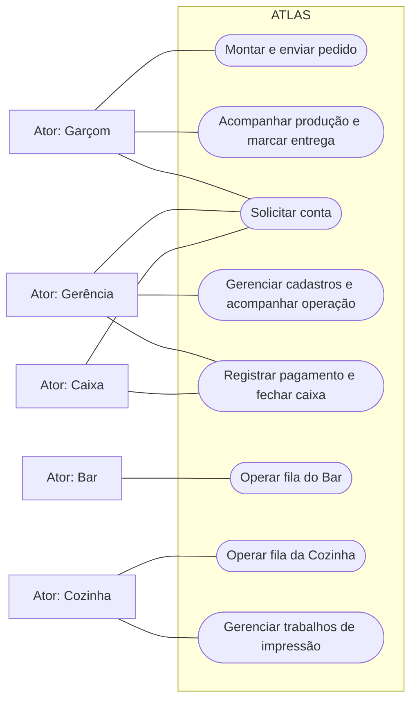
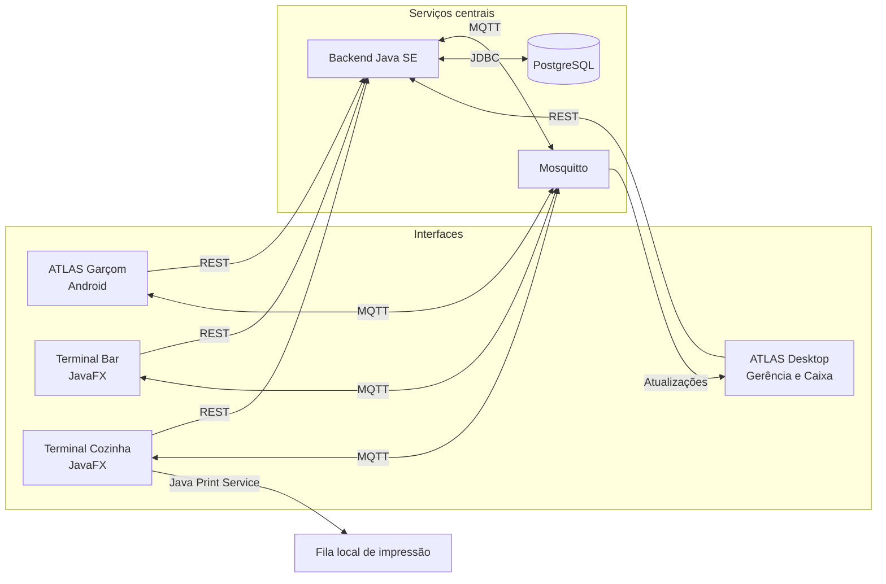
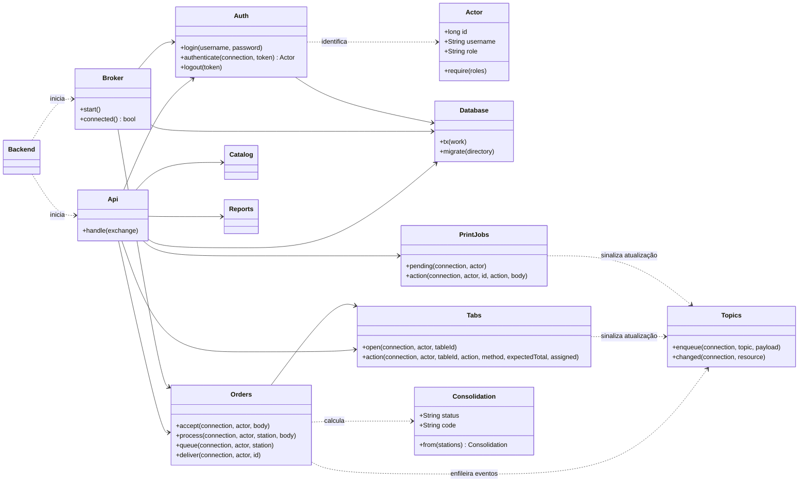
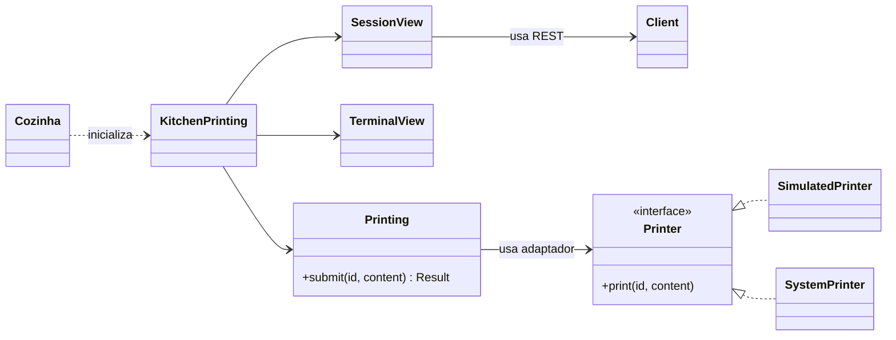
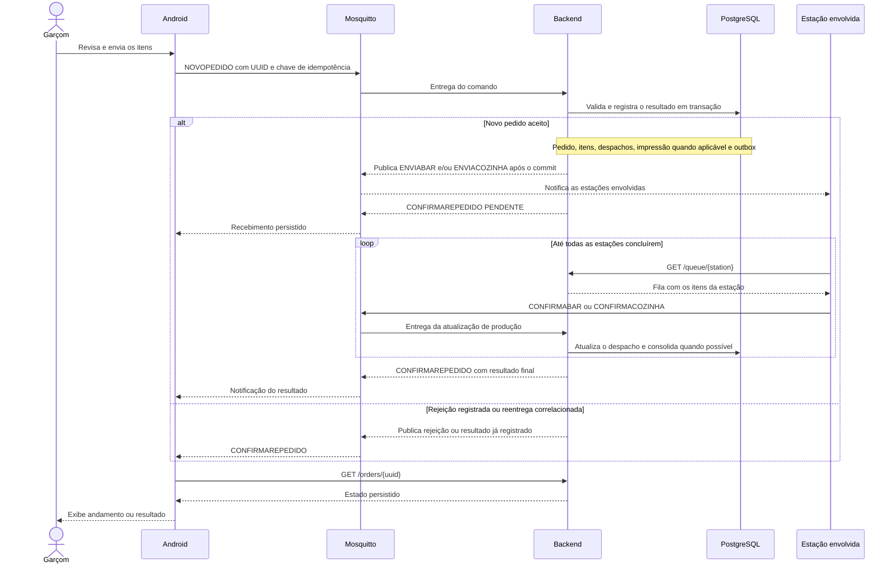
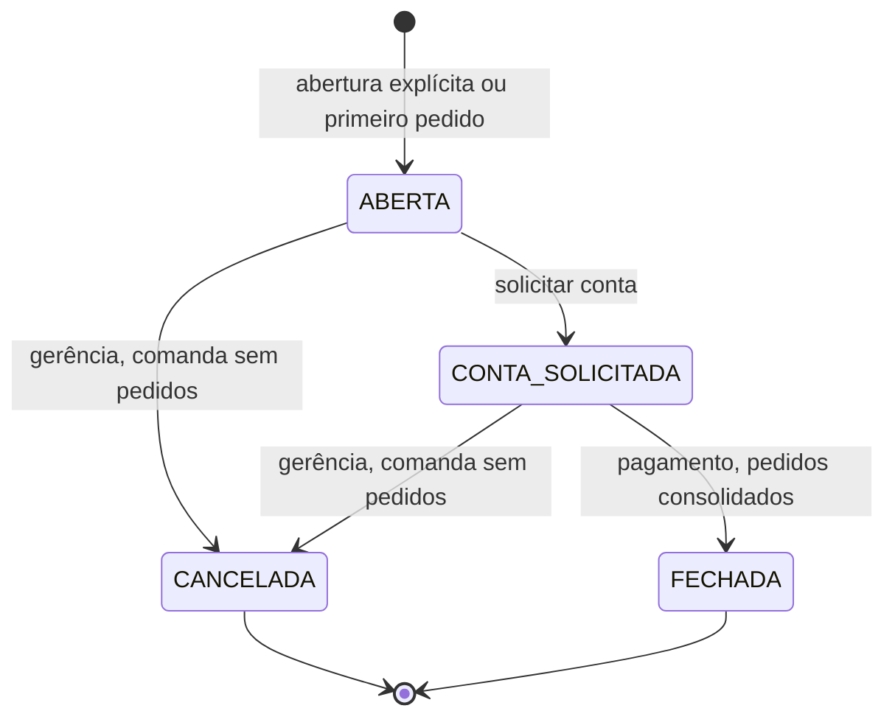
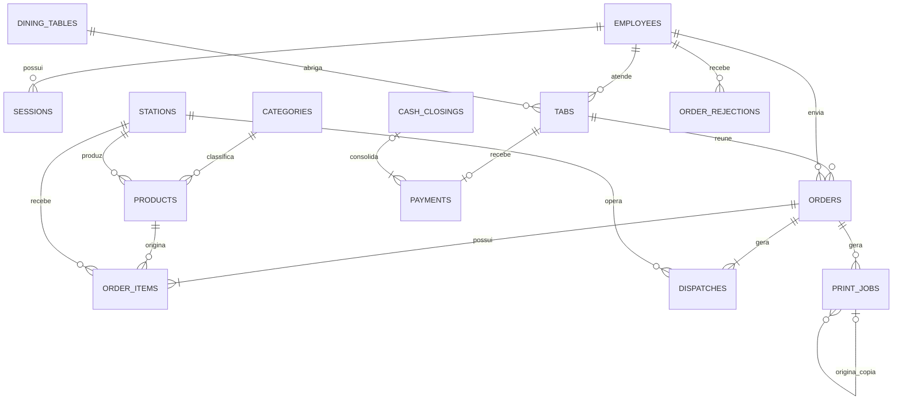

# ATLAS v.1.0

O ATLAS organiza o atendimento e a produção de um restaurante. O garçom lança pedidos pelo Android, o bar e a cozinha recebem suas filas de produção, e a gerência e o caixa acompanham as comandas no Desktop. O Backend centraliza regras e permissões e registra pedidos, pagamentos, trabalhos de impressão e eventos de auditoria no PostgreSQL.

**Versão documentada** `1.0` · **Ambiente de execução documentado** Windows · **Linguagem** Java

Para instalar, abrir as telas e testar um pedido no mesmo computador, siga o [guia de uso do Desktop e do Mobile](00%20-%20Documentacao%20Geral/Manuais/Uso-Desktop-e-Mobile.md).

## Sumário

- [Perfis e casos de uso](#perfis-e-casos-de-uso)
- [Arquitetura](#arquitetura)
- [UML de classes](#uml-de-classes)
- [Fluxo de pedidos](#fluxo-de-pedidos)
- [Comandas e pagamentos](#comandas-e-pagamentos)
- [Impressão na cozinha](#impressão-na-cozinha)
- [Modelo de dados](#modelo-de-dados)
- [Interfaces e autenticação](#interfaces-e-autenticação)
- [Instalação e execução](#instalação-e-execução)
- [Primeira operação](#primeira-operação)
- [Estrutura do repositório](#estrutura-do-repositório)
- [Testes e limites da validação](#testes-e-limites-da-validação)
- [Origem do projeto](#origem-do-projeto)

## Perfis e casos de uso

| Perfil | Interface | Operações principais |
| --- | --- | --- |
| `GERENTE` | Desktop | Cadastrar mesas, produtos e funcionários, acompanhar pedidos e filas, atribuir comandas, receber pagamentos, fechar o caixa e consultar relatórios, auditoria e configurações. |
| `CAIXA` | Desktop | Consultar comandas e a fila de fechamento, registrar pagamentos, fechar o caixa e consultar relatórios. |
| `GARCOM` | Android | Consultar mesas e cardápio, abrir a própria comanda, montar e enviar pedidos, acompanhar a produção, registrar a entrega e solicitar a conta. |
| `BAR` | Terminal Bar | Consultar a fila de bebidas e dos demais produtos atribuídos ao Bar, iniciar a preparação e registrar conclusão ou falha. |
| `COZINHA` | Terminal Cozinha | Consultar a fila da Cozinha, registrar preparação, concluir ou registrar falha e acompanhar trabalhos de impressão. |

O Backend confere o perfil e, quando aplicável, a titularidade da comanda ou do pedido. O mapa representa os principais casos de uso do ponto de vista de cada ator.



## Arquitetura

O Backend fornece a API REST, processa comandos MQTT e coordena as transações em PostgreSQL. Android, Desktop e terminais consultam dados por REST. O MQTT transporta os pedidos, os despachos, as confirmações de produção e os avisos de atualização. O terminal da Cozinha executa a impressão no computador onde a fila da impressora está configurada.



| Camada | Tecnologias |
| --- | --- |
| Backend | Java 21, servidor HTTP do JDK, JDBC, driver PostgreSQL 42.7.9 e Gson 2.13.2. |
| Desktop e terminais | JavaFX, FXML e CSS. Os módulos compartilham o cliente HTTP e o gerenciamento de sessão e eventos MQTT. |
| Android | Java, Android SDK 35, SDK mínimo 24, Gradle Wrapper 8.11.1 e Android Gradle Plugin 8.9.2. |
| Mensageria | Eclipse Mosquitto 2, Eclipse Paho 1.2.5, JSON versionado, QoS 1 e sessões persistentes onde configuradas. |
| Persistência | PostgreSQL 17, migrations SQL versionadas e publicações pendentes armazenadas em `outbox`. |
| Impressão | Adaptador simulado em arquivo ou adaptador local via Java Print Service. |
| Ferramentas | PowerShell, BlueJ, Scene Builder e Android Studio. Docker Compose é uma opção para executar PostgreSQL e Mosquitto. |

Consulte a [descrição da arquitetura](00%20-%20Documentacao%20Geral/Arquitetura/Arquitetura.md) e os [diagramas operacionais](00%20-%20Documentacao%20Geral/Diagramas/Operacao.md).

## UML de classes

O [conjunto completo de diagramas UML](00%20-%20Documentacao%20Geral/Diagramas/UML/README.md) inclui fontes PlantUML editáveis e imagens SVG dos módulos, da implantação e dos fluxos do sistema.

### Backend

O diagrama usa os nomes das classes Java e mostra suas principais dependências. `Api` recebe chamadas HTTP. `Broker` recebe comandos MQTT e publica eventos. Os dois usam `Auth` para identificar funcionários e `Database` para executar transações. `Orders` e `Tabs` concentram as regras de pedidos e comandas.



### Cliente da cozinha e impressoras

`KitchenPrinting` coordena o trabalho local por meio de `Printing`. Os dois adaptadores implementam a interface `Printer`. O serviço `PrintJobs` permanece no Backend como responsável pelo estado persistido da fila.



No Android, `MesaFragment`, `CardapioFragment`, `ComandaFragment` e `HistoricoFragment` implementam o fluxo do garçom. `ComandaTemporaria` representa os itens em edição e `SessaoUsuario` coordena a autenticação, as consultas REST e a publicação dos pedidos.

## Fluxo de pedidos

1. O garçom entra no aplicativo, seleciona a mesa, adiciona itens e revisa o pedido.
2. O Android registra localmente o comando pendente e publica `NOVOPEDIDO` com o identificador do pedido e a chave de idempotência.
3. O Backend valida a sessão, a mesa, a comanda e os produtos. Ao aceitar o pedido, registra os itens com os preços vigentes e cria despachos somente para as estações envolvidas. Se houver itens de cozinha, também cria o trabalho original de impressão.
4. Os eventos de despacho, o recibo `PENDENTE` e a atualização de estado entram na mesma transação PostgreSQL. Após o commit, o publicador envia os eventos pendentes ao Mosquitto.
5. Cada estação opera sua fila e informa `PREPARANDO`, `OK` ou `ERRO`. O Backend consolida o resultado quando todas as estações envolvidas chegam a um estado final.
6. O Android recebe `CONFIRMAREPEDIDO` e consulta o Backend para acompanhar o estado persistido, inclusive após reconexão.



| Estado do pedido | Significado |
| --- | --- |
| `PENDENTE` | Produção ainda em aberto em pelo menos uma estação. |
| `CONFIRMADO` | Todas as estações envolvidas terminaram com sucesso. |
| `PARCIAL` | Pelo menos uma estação terminou com sucesso e outra registrou falha. |
| `ERRO` | Todas as estações envolvidas registraram falha. |
| `REJEITADO` | Resultado de validação registrado em `order_rejections` para o comando correlacionado. |

O código de consolidação tem dois dígitos, na ordem **Cozinha–Bar**. Cada dígito vale `1` para sucesso ou ausência da estação naquele pedido e `0` para falha. Por exemplo, `01` indica erro na Cozinha e sucesso ou ausência do Bar. Para interpretar corretamente pedidos de uma única estação, use o código em conjunto com o estado e a lista de estações envolvidas.

O par funcionário–chave de idempotência evita a criação duplicada do pedido. Os clientes combinam notificações MQTT com consultas REST. Como uma mensagem QoS 1 pode ser entregue novamente, o estado persistido é a referência para reconciliação.

## Comandas e pagamentos

Uma mesa pode ter várias comandas ao longo do tempo e, no máximo, uma comanda ativa. `ABERTA` e `CONTA_SOLICITADA` são os estados ativos. Quando a gerência abre uma comanda, vincula um garçom ativo. O primeiro pedido também pode abrir a comanda automaticamente.



O total usa quantidade e preço registrado de cada item cuja estação concluiu com `OK`, depois da consolidação do pedido. O Backend bloqueia o pagamento se houver pedidos pendentes ou se o valor esperado pelo caixa divergir do cálculo atual. A confirmação registra pagamento por PIX, dinheiro ou cartão, fecha a comanda e libera a mesa na mesma transação. O fechamento de caixa é uma operação posterior que reúne os pagamentos ainda sem fechamento associado.

## Impressão na cozinha

1. Um pedido com itens da Cozinha cria um trabalho original em `print_jobs`.
2. O terminal consulta os trabalhos pendentes e solicita a atribuição. O Backend incrementa a tentativa e registra o operador e a chave de atribuição.
3. O terminal envia o conteúdo ao adaptador local e informa o resultado associado à mesma chave. O resultado pode ser `IMPRESSO`, `FALHA` ou `INCERTO`.
4. `FALHA` permite retentar o mesmo trabalho. `IMPRESSO` e `INCERTO` permitem criar uma cópia com UUID próprio e referência ao trabalho de origem. O operador pode cancelar um trabalho pendente ou em falha.

| Configuração | Comportamento |
| --- | --- |
| `ATLAS_PRINT_MODE=simulado` | Gera comprovantes em `.local/comprovantes` por padrão. `ATLAS_PRINT_OUTPUT` define o diretório. |
| `ATLAS_PRINT_MODE=sistema` | Envia à fila configurada por `ATLAS_PRINTER_NAME` no computador do terminal. |

A conclusão da produção e o resultado da impressão têm registros independentes. No modo `sistema`, `IMPRESSO` sinaliza que o adaptador concluiu o envio à fila do sistema. A saída em papel faz parte da verificação no equipamento. [Manual de impressão e recuperação](00%20-%20Documentacao%20Geral/Manuais/Impressora.md)

## Modelo de dados

O diagrama entidade–relacionamento complementa a UML de classes. Ele mostra as principais tabelas e suas relações no PostgreSQL.



| Dados | Regras de persistência |
| --- | --- |
| `employees`, `sessions` | Identidade, perfil, estado da conta e sessões com expiração. |
| `dining_tables`, `tabs` | A unicidade da comanda ativa por mesa é aplicada pelo PostgreSQL. |
| `products`, `order_items` | O item registra nome, categoria, estação, preço unitário, quantidade e observação do pedido. Alterar um produto preserva os valores já registrados. |
| `orders`, `dispatches`, `order_rejections` | O pedido guarda o resultado consolidado. O despacho guarda o estado de cada estação. As rejeições correlacionadas ficam em tabela própria. |
| `payments`, `cash_closings` | Há até um pagamento por comanda. Cada pagamento pode ser associado a um fechamento. |
| `print_jobs`, `audit_events`, `outbox`, `operational_settings` | Fila de impressão e cópias, trilha de auditoria, eventos a publicar e configurações da operação. |

O Backend aplica as migrations durante a inicialização e registra as versões em `schema_versions`. Os scripts SQL ficam em [Banco de Dados](07%20-%20Infraestrutura/Banco%20de%20Dados/).

## Interfaces e autenticação

| Interface | Usos e exemplos |
| --- | --- |
| REST, prefixo `/api/v1/` | Login, cardápio, mesas, histórico, filas, comandas, pagamentos e impressão. Exemplos `GET /health`, `POST /login`, `GET /orders/{uuid}`, `POST /tabs/{tableId}/pay`. |
| MQTT, prefixo `atlas/v1/` | Comando `NOVOPEDIDO`, despachos `ENVIABAR` e `ENVIACOZINHA`, atualizações de estação, `CONFIRMAREPEDIDO` e notificações `ATUALIZACAO`. |

O login REST emite um token de sessão opaco e com validade de 12 horas. Requisições protegidas usam `Authorization: Bearer <token>`. O PostgreSQL armazena hashes dos tokens e as senhas de funcionários usam PBKDF2-HMAC-SHA256. O acesso ao Mosquitto usa uma credencial individual e uma ACL compatível com o perfil. O Backend confere novamente o usuário e o papel quando recebe um comando.

- [Contrato REST](00%20-%20Documentacao%20Geral/Arquitetura/API.md)
- [Arquivo OpenAPI](00%20-%20Documentacao%20Geral/Arquitetura/openapi.yaml)
- [Eventos, campos e tópicos MQTT](00%20-%20Documentacao%20Geral/Arquitetura/MQTT.md)

## Instalação e execução

### Pré-requisitos

- Windows e PowerShell, com JDK 21 e JavaFX para os módulos desktop. Os scripts reconhecem o JDK e o JavaFX do BlueJ em `C:\Program Files\BlueJ`.
- PostgreSQL 17 e Mosquitto 2. O modo portátil espera os binários Windows em `.local/pgsql/bin` e `.local/mosquitto`. A configuração do Compose fica em `07 - Infraestrutura/Docker`.
- Para o Android, Android Studio ou o ambiente do Gradle com JDK 17 ou 21 e Android SDK 35.

### Modo portátil

Execute na raiz do projeto.

```powershell
& '.\07 - Infraestrutura\Scripts\Build.ps1'
& '.\07 - Infraestrutura\Scripts\Start-Portable.ps1'
Invoke-RestMethod 'http://127.0.0.1:8080/api/v1/health'
& '.\07 - Infraestrutura\Scripts\Run.ps1' -Module Desktop
```

A primeira inicialização prepara um banco vazio e registra as credenciais iniciais da gerência em `.local/portable/gerencia.txt`. A API escuta em `127.0.0.1:8080`, o Mosquitto em `127.0.0.1:1883` e o PostgreSQL portátil em `127.0.0.1:55433`. Use `.env.example` como referência das variáveis de ambiente e mantenha as credenciais locais em acesso restrito.

Abra cada terminal em uma janela de PowerShell própria.

```powershell
& '.\07 - Infraestrutura\Scripts\Run.ps1' -Module Bar
& '.\07 - Infraestrutura\Scripts\Run.ps1' -Module Cozinha
```

Encerre a instância portátil com o seguinte comando.

```powershell
& '.\07 - Infraestrutura\Scripts\Start-Portable.ps1' -Action Stop
```

### Android

Abra `03 - Mobile/AndroidApp` no Android Studio ou execute o Gradle Wrapper nessa pasta.

```powershell
.\gradlew.bat :app:assembleDebug :app:testDebugUnitTest :app:lintDebug
```

O APK de depuração é gerado em `app/build/outputs/apk/debug/app-debug.apk`. No emulador Android padrão, use `http://10.0.2.2:8080` para a API e `tcp://10.0.2.2:1883` para o Mosquitto. A versão release exige HTTPS e MQTT sobre TLS. Para aparelhos físicos, Docker Compose, TLS, BlueJ e Scene Builder, consulte o [guia de instalação e rede](00%20-%20Documentacao%20Geral/Manuais/Instalacao.md).

## Primeira operação

1. Entre no Desktop com a gerência. Cadastre uma mesa, um funcionário de cada perfil que será usado e produtos para as estações Bar e Cozinha.
2. Provisione no Mosquitto uma conta para cada funcionário, com o mesmo código usado no Desktop e a ACL correspondente. Após provisionar, reinicie o broker conforme o guia. O [procedimento de cadastro MQTT](00%20-%20Documentacao%20Geral/Manuais/Instalacao.md#instância-portátil) inclui os comandos.
3. Entre nos terminais com os perfis `BAR` e `COZINHA`. Em cada login, informe as credenciais individuais da API e do broker.
4. Entre no Android com um perfil `GARCOM`, selecione a mesa e envie um pedido com um produto de cada estação.
5. Conclua o preparo nos dois terminais e acompanhe a atualização no Android. No modo simulado, confira o arquivo do trabalho de impressão no computador da cozinha.
6. Solicite a conta no Android. No Desktop, um usuário de Caixa ou Gerência seleciona a comanda, confere o total, registra o pagamento e verifica a liberação da mesa.

## Estrutura do repositório

| Módulo | Conteúdo |
| --- | --- |
| [00 - Documentação Geral](00%20-%20Documentacao%20Geral/README.md) | Arquitetura, contratos, diagramas, manuais e auditoria de origem. |
| [01 - Backend](01%20-%20Backend/README.md) | Entrada `atlas.Backend`, API, autenticação, serviços de aplicação, acesso JDBC e MQTT. |
| [02 - Desktop](02%20-%20Desktop/README.md) | JavaFX para Gerência e Caixa, com telas FXML, CSS e recursos visuais. |
| [03 - Mobile](03%20-%20Mobile/README.md) | Aplicativo Android do garçom em `AndroidApp`. |
| [04 - Terminal Bar](04%20-%20Terminal%20Bar/README.md) | Interface da estação Bar. |
| [05 - Terminal Cozinha](05%20-%20Terminal%20Cozinha/README.md) | Interface da estação Cozinha e coordenação da impressão local. |
| [06 - Impressão](06%20-%20Impressao/README.md) | Contrato `Printer`, serviço `Printing` e adaptadores de saída. |
| [07 - Infraestrutura](07%20-%20Infraestrutura/README.md) | Migrations, configuração MQTT, Compose e scripts PowerShell. |
| [08 - Testes](08%20-%20Testes/README.md) | Testes de Backend, MQTT, JavaFX e fluxo instrumentado Android. |
| [09 - Clientes JavaFX](09%20-%20Clientes%20JavaFX/README.md) | Componentes de sessão, REST, MQTT e telas compartilhadas pelos clientes desktop. |

## Testes e limites da validação

| Área | Verificação registrada |
| --- | --- |
| Backend e MQTT | Oito cenários com PostgreSQL e Mosquitto reais, cobrindo pedidos por estação, pedidos mistos, falhas de produção, reentrega, desconexão e retentativa de impressão. |
| BlueJ e JavaFX | Compilação do Backend no BlueJ, carregamento de 18 FXML, navegação no Desktop e confirmação de pedido misto pelas interfaces dos terminais. |
| Android | Testes JVM e lint. O fluxo instrumentado passou no Android 35, do login até o envio, a confirmação do Bar e a consulta no histórico. A compilação gerou APK debug e release sem assinatura. |
| Infraestrutura | A instância portátil foi iniciada, verificada e reiniciada. A configuração do Compose passou por validação estrutural. |

A validação física da impressora USB, a execução pelo Docker Compose e a abertura no Scene Builder ainda precisam ser feitas no ambiente correspondente. O Desktop usa ocupação por mesa e produção em duas estações. A conferência visual do Android depende da imagem original de referência citada nos anexos de texto. [Como reproduzir os testes](08%20-%20Testes/README.md)

## Origem do projeto

O ATLAS foi organizado na branch local `atlas-v1.0`, a partir do histórico do Restaurant-system-POOWork. O aplicativo em `03 - Mobile/AndroidApp` foi incorporado da branch `Front`, revisão `1c2b8f314d42479b8c2ac0f477ac538943abab48`. O Desktop foi desenvolvido com base nos recursos e padrões visuais do Figma do ATLAS. [Auditoria de origem e decisões](00%20-%20Documentacao%20Geral/Arquitetura/Auditoria.md)
